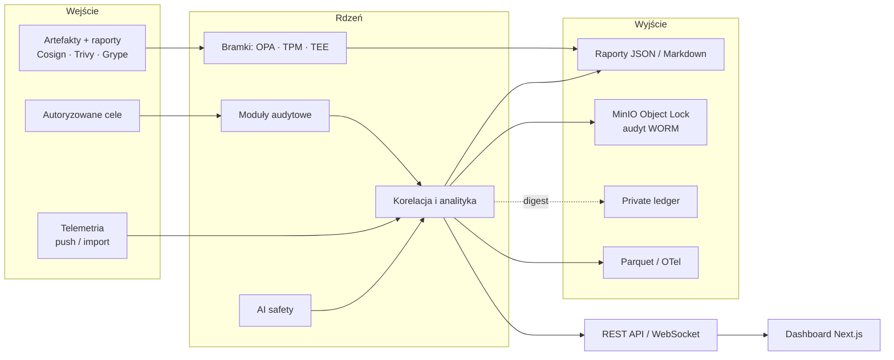

<div align="center">

# SANCTUM-SUITE

### Modułowy zestaw narzędzi do inżynierii bezpieczeństwa

**Verify · Attest · Audit — zaufanie do łańcucha dostaw, danych i decyzji.**

CLI, API i dashboard dla audytów autoryzowanych, analizy zdarzeń, weryfikacji supply chain oraz eksperymentów z privacy-enhancing technologies i AI safety.

<p>
  <a href="https://github.com/KarolMrozinski/sanctum-suite/actions/workflows/ci.yml"></a>
  <a href="https://github.com/KarolMrozinski/sanctum-suite/actions/workflows/security.yml"></a>
  
  
</p>
<p>
  
  
  
  
</p>

[**Szybki start**](#-szybki-start) ·
[**Moduły**](#-moduły) ·
[**Runbook Air-Gap**](./DEPLOYMENT.md) ·
[**Dokumentacja**](#-dokumentacja) ·
[**Bezpieczeństwo**](./SECURITY.md)

</div>

---

## ✨ Najważniejsze cechy

| | |
|---|---|
| 🔐 **Supply chain** | Cosign/Sigstore, in-toto, raporty Trivy/Grype, SBOM CycloneDX |
| 🧾 **Executive report** | Jeden raport JSON + Markdown dla audytorów |
| 🛡️ **Trust & attestation** | TPM/Measured Boot (Keylime), SEV-SNP / TDX / SGX, polityki OPA |
| 📦 **Air-Gap** | Podman, MinIO Object Lock, weryfikacja offline |
| 🔭 **Telemetria** | Parquet/Arrow, sandbox Wasmtime, OpenTelemetry |
| 🧪 **Privacy-enhancing tech** | FHE, HSM/PKCS#11, Apache AGE, SMPC, ZK, private ledger |

## 🗺️ Spis treści

[O projekcie](#-o-projekcie) · [Status i ograniczenia](#-status-i-ograniczenia) · [Moduły](#-moduły) · [Szybki start](#-szybki-start) · [Aktywne testy](#-aktywne-testy) · [Architektura](#-architektura) · [Telemetria i audyt](#-telemetria-i-audyt) · [Dokumentacja](#-dokumentacja) · [Licencja](#-licencja)

## 📌 O projekcie

SANCTUM-SUITE to rozwijany zestaw modułów przeznaczonych do pracy w kontrolowanych, zatwierdzonych środowiskach. Łączy narzędzia CLI, REST API i WebSocket, funkcje analityczne oraz opcjonalny dashboard Next.js.

## ⚠️ Status i ograniczenia

> [!WARNING]
> Projekt ma status **beta**. Obecność funkcji w repozytorium **nie oznacza**, że została niezależnie zweryfikowana, jest gotowa do wdrożenia produkcyjnego ani że zapewnia zgodność z określonym standardem.

<details>
<summary><b>Kluczowe zastrzeżenia (kliknij, aby rozwinąć)</b></summary>

<br>

- **Moduły eksperymentalne** — część funkcji jest zależna od platformy lub stanowi wyłącznie punkt integracji. Brak integracji jest raportowany jako brak oceny, a nie jako wynik pozytywny.
- **TPM / Measured Boot** — aplikacja nie komunikuje się bezpośrednio z TPM ani samodzielnie nie weryfikuje quote. Produkcyjny gate odczytuje status atestacji z zewnętrznego verifiera Keylime.
- **Confidential Computing (SEV-SNP / TDX / SGX)** — gate ufa operator-managed claims gateway (Trustee albo osobny verifier DCAP dla SGX) i wymaga zatwierdzonych pomiarów workloadu. Repozytorium nie dostarcza verifiera ani sprzętowej enklawy.
- **Brak wbudowanych integracji** — skanowania kontenerów/SBOM w aplikacji, analizy firmware i pamięci, telemetrii EDR/XDR, inspekcji GPU ani magazynowania danych niejawnych. CI skanuje obraz kontenera i tworzy jego SBOM; pipeline wydania przygotowuje SBOM CycloneDX (pakiet Python, dashboard, obraz) i podpisane attestations. Nie oznacza to skanowania wdrożonych systemów ani certyfikacji.
- **Funkcje symulowane** — kampanie red-team, C2/covert-channel, spoofing satelitarny, biometria, hot-patching i dead-man switch nie wykonują opisanych działań.
- **Dashboard** — nie otrzymuje obecnie rzeczywistej telemetrii przez WebSocket. Dane można po jawnej konfiguracji źródła importować przez zabezpieczone API i przeglądać w Workbench.
- **Brak certyfikacji** — build, testy i dokumentacja nie stanowią certyfikacji bezpieczeństwa, zgodności ani gwarancji skuteczności.

### Zarządzanie kluczami, tożsamość i audyt dostępu

- `ZeroTrustKMSVault` działa lokalnie z kluczem efemerycznym wyłącznie w trybie developerskim albo przez jawnie skonfigurowany HashiCorp Vault Transit. Tryb produkcyjny i air-gapped wymaga Vault Transit; Vault Transit szyfruje tylko dane jawnie przekazane do helpera (nie baz SQLite, logów ani kopii zapasowych). Zobacz [Vault Transit](./docs/INSTALLATION.md#vault-transit-key-management).
- **OIDC** wymaga jawnej konfiguracji issuer, audience, mapowania claimów i zabezpieczonego katalogu tenantów; nie zawiera interaktywnego logowania ani odświeżania tokenów. Profil produkcyjny/air-gapped wymaga OIDC, Vault Transit i MinIO Object Lock, a współdzielone klucze API są w nim odrzucane. Legacy API i analytics endpoints nie są dostępne dla tożsamości OIDC, ponieważ raportowanie nie jest tenant-scoped. Zobacz [OIDC i dane tenantów](./docs/INSTALLATION.md#oidc-users-roles-and-tenant-scoped-data).
- Lokalny SQLite access audit nie jest immutable ani tamper-proof. MinIO Object Lock może przechowywać minimalne, pseudonimizowane metadane żądań w trybie fail-closed przez 7 lat. Zobacz [MinIO WORM](./docs/INSTALLATION.md#minio-immutable-access-audit).
- Żaden z tych mechanizmów nie certyfikuje środowiska ani nie dopuszcza do przetwarzania informacji niejawnych.

</details>

## 🧩 Moduły

### Audyt, analiza i AI safety

| Moduł | Opis |
|---|---|
| **Aktywne audyty** | Jawnie autoryzowane testy HTTPS/TCP z kontrolą dozwolonych celów (patrz [Aktywne testy](#aktywne-testy)). |
| **Incident response** | Lokalna korelacja zdarzeń, trwałe sprawy SQLite, przypisania, statusy, notatki i odnośniki do dowodów, symulowane rekomendacje reakcji, audyt dostępu, opcjonalna retencja, fikcyjne scenariusze demo. Brak domyślnie aktywnych integracji dostawców i automatycznych reakcji. |
| **AI safety** | Analiza promptów i eksperymenty z zabezpieczeniami modeli. |
| **Interfejsy** | CLI w Pythonie, REST API, WebSocket oraz dashboard Next.js. |
| **Kontrole i entitlementy** | Mapowanie kontroli, weryfikacja podpisanych uprawnień; skonfigurowane API może egzekwować polityki OPA i blokować operacje przy nieaktualnej atestacji TPM/Measured Boot z Keylime. |

### Weryfikacja i raportowanie

| Moduł | Polecenie | Opis |
|---|---|---|
| **Security readiness** | `sanctum security-readiness` | Raport JSON z jawnie podanych deklaracji eBPF / Rust / SPIFFE-SPIRE / PQC i inwentarza kryptografii (w tym PQXDH jako protokół wymagający osobnego przeglądu). Nie bada działającego kernela, projektu Rust, wdrożenia SPIRE ani faktycznego użycia kryptografii. |
| **Supply chain** | `sanctum supply-chain-verify` | Weryfikacja Cosign/Sigstore in-toto attestation dla lokalnego artefaktu względem wskazanej tożsamości/issuera oraz podsumowanie raportów Trivy i Grype. Nie uruchamia skanerów i nie uznaje raportów za kryptograficznie uwierzytelnione. |
| **Executive report** | `sanctum generate-executive-report` | Scala raporty gotowości, łańcucha dostaw i testów OPA do JSON i Markdown. Nie zastępuje eksperckiego przeglądu ani oceny zgodności. Kroki pracy offline: [DEPLOYMENT.md](./DEPLOYMENT.md). |
| **Telemetry archive** | `sanctum telemetry-archive` | Opcjonalny eksport znormalizowanych zdarzeń do Parquet (Arrow), transformacja w sandboxie Wasmtime i ograniczone ślady OTel do jawnie skonfigurowanego Collectora. [Dokumentacja](./docs/TELEMETRY_PIPELINE.md). |

### Blockchain i zgodność (eksperymentalne)

| Moduł | Opis |
|---|---|
| **Dane on-chain** | Jawnie konfigurowane, read-only klienty Bitcoin Core i Ethereum JSON-RPC: wspólny model bloków i transakcji, graf sprawy, zdarzenia `Transfer`, ograniczone ślady `callTracer`. Case-scoped Crypto OSINT korzysta wyłącznie z importowanych, niezweryfikowanych raportów; snapshoty bloków są domyślnie wyłączone. Brak deklaracji zgodności AML/MiCA. [Dokumentacja](./docs/ONCHAIN_ANALYSIS.md). |
| **Checklist AML/MiCA** | Checklist sprawy i append-only rejestr referencji dowodów dla przeglądu MiCA, AMLR, TFR i polskiej ustawy AML (CASP w UE). Nie ocenia zgodności — wszystkie sprawy zachowują status `NOT_ASSESSED`. [Dokumentacja](./docs/AML_MICA_CASE_REVIEW.md). |
| **Dowód ZK** | Obwód Groth16 dowodzi, że prywatnie zakodowane oceny dostawcy nie przekraczają progu `medium`, bez ich publikowania. Dowód nie uwierzytelnia dostawcy ani raportu i nie jest połączony z przypadkiem; wymagany jest niezależny ceremony setup. [Dokumentacja](./docs/ZK_AUDIT_PROOFS.md). |

### Privacy-enhancing technologies (eksperymentalne)

| Moduł | Polecenie | Opis |
|---|---|---|
| **Prywatny agregat grafu (FHE / HSM / AGE)** | `sanctum fhe-*`, `sanctum privacy-graph-*` | Backend Apache AGE przechowuje graf sprawy i szyfrogramy ocen BFV (Microsoft SEAL). Klucz prywatny pozostaje po stronie klienta, a osobny klucz RSA w HSM/PKCS#11 podpisuje manifest. FHE umożliwia wyłącznie sumowanie liczb całkowitych; graf i identyfikatory w AGE pozostają jawne. [Dokumentacja](./docs/PRIVATE_GRAPH_FHE.md). |
| **Prywatne poświadczenia audytu (DP / DID / VC)** | `POST /api/v1/privacy/credentials` | Podpisuje Ed25519 VC-JWT z histogramem kategorii zaszumionym dyskretnym mechanizmem Laplace'a; budżet epsilon jest kumulowany per stabilny dataset ID. Prototyp z DID `did:key`; wymaga trwałego magazynu budżetu i jawnie skonfigurowanego klucza. Nie jest post-quantum, wielotenantowy ani produkcyjnie certyfikowany. [Dokumentacja](./docs/PRIVACY_CREDENTIALS.md). |
| **Private ledger** | `sanctum ledger-anchor`, `sanctum ledger-verify` | Weryfikuje podpisany checkpoint i świeżą atestację SNP lub SGX, po czym zapisuje wyłącznie digest SHA-256 w lokalnym ledgerze demo (SQLite) albo przez operator-managed gateway Hyperledger Fabric. Repozytorium nie zawiera Fabric chaincode ani verifiera Intel DCAP. [Dokumentacja](./docs/PRIVATE_LEDGER.md). |
| **SMPC** | `sanctum smpc-aggregate-demo` | Trzy lokalne procesy MPyC wspólnie obliczają sumę ograniczonych liczb i bit progu, ujawniając wyłącznie agregat. Prototyp lokalny w modelu semi-honest — bez ochrony przed aktywnie złośliwymi uczestnikami i bez izolacji organizacyjnej. Wymaga extra `smpc`. [Dokumentacja](./docs/SMPC.md). |

## 🚀 Szybki start

> [!IMPORTANT]
> **Uwaga licencyjna:** przed instalacją, uruchomieniem, modyfikacją lub wdrożeniem uzyskaj wymaganą pisemną zgodę właściciela praw. Licencja pozwala na wgląd w kod w celach oceny, edukacyjnych lub code review; nie przyznaje ogólnego prawa do jego wykonywania ani użycia komercyjnego.

### Wymagania

- Python 3.11 lub nowszy
- Node.js i npm — tylko dla dashboardu
- Pisemna zgoda na użycie programu oraz osobna autoryzacja każdego testowanego celu

### Instalacja pakietu Python

```powershell
py -3.11 -m venv .venv
.\.venv\Scripts\Activate.ps1
python -m pip install --upgrade pip
python -m pip install -e .
```

Opcjonalne extras: `telemetry`, `privacy-graph`, `smpc`, np. `python -m pip install -e ".[smpc]"`.

Weryfikacja instalacji:

```powershell
sanctum --help
python -m pytest -q
```

### Dashboard (opcjonalnie)

```powershell
Set-Location .\sanctum-dashboard
npm ci
Copy-Item .env.example .env.local
npm run build
npm run start
```

Konfigurację API, TLS, sekretów i dashboardu opisuje [przewodnik instalacji](./docs/INSTALLATION.md).

## 🎯 Aktywne testy

> [!CAUTION]
> Nie uruchamiaj testów wobec systemów spoza zatwierdzonego zakresu.

Aktywne audyty i skanowanie portów są blokowane, dopóki operator nie skonfiguruje wszystkich wymaganych elementów:

1. dokładnej listy celów w `SANCTUM_AUTHORIZED_TARGETS` (bez wildcardów),
2. identyfikatora pisemnej zgody przekazywanego przy uruchomieniu,
3. ważnego, podpisanego entitlementu oraz klucza publicznego do jego weryfikacji.

```powershell
sanctum run-audit --target zatwierdzony.example --authorization-reference "identyfikator-zgody"
```

Wartość `--authorization-reference` służy do prowadzenia śladu audytowego i sama w sobie nie potwierdza zgody. Nie uruchamiaj testów wobec systemów spoza zatwierdzonego zakresu. Szczegóły: [Entitlementy komercyjne](./docs/COMMERCIAL_ENTITLEMENTS.md).

## 🏗️ Architektura

Diagram przedstawia orientacyjny podział obszarów repozytorium, a nie gwarantowany przepływ danych ani wdrożony układ infrastruktury.



## 📡 Telemetria i audyt

### Ingestia telemetrii

Integracja jest **domyślnie wyłączona** i vendor-neutral. Operator konfiguruje po stronie serwera:

- `SANCTUM_EVENT_SOURCE_KEYS` — mapa ID źródła → osobny sekret (min. 32 bajty),
- `SANCTUM_EVENT_RETENTION_DAYS` — polityka retencji (1–36500 dni).

Sekrety należy przechowywać w menedżerze sekretów, nigdy w dashboardzie ani repozytorium. Bez obu ustawień przyjmowanie danych jest zablokowane.

| Ścieżka | Opis |
|---|---|
| **Push API** | `POST /api/v1/telemetry/ingest`, nagłówki `X-Sanctum-Source-ID` i `X-Sanctum-Source-Key`. |
| **Import plików** | `POST /api/v1/telemetry/import`; JSON, JSONL i CEF, do 4 MB i 1000 zdarzeń na import. W Workbench można załadować plik i przeglądać zapisane zdarzenia. |
| **Pull** | Zabezpieczony endpoint do ręcznego uruchamiania jawnie zarejestrowanych adapterów oraz wspólny kontrakt mapowania. Brak konektora konkretnego dostawcy, harmonogramu pobierania i domyślnych połączeń wychodzących. |

Zdarzenia przechodzą walidację wspólnego schematu i trafiają do SQLite. Surowe payloady nie są zapisywane; identyfikatory źródłowe i tokeny korelacji są pseudonimizowane, a powtórzenia deduplikowane (produkcja: kluczowany HMAC z odrębnymi przestrzeniami nazw; dev: SHA-256). Etykiety zdarzeń i reguł muszą być ustrukturyzowane, bez tekstu swobodnego. Korelacja grupuje wyłącznie dokładne dopasowania tokenów w skonfigurowanym oknie czasu — nie jest detekcją ani oceną zagrożenia. Tokeny pseudonimowe nie są anonimowe; przed wysłaniem danych ogranicz je do niezbędnego zakresu i stosuj zatwierdzoną politykę pseudonimizacji.

Podłączenie tej ścieżki nie uruchamia automatycznych reakcji ani nie zasila strumienia WebSocket. Szczegóły: [przewodnik instalacji](./docs/INSTALLATION.md#preparing-external-telemetry-ingestion).

### Weryfikowalny audyt WORM

W trybie produkcyjnym API zapisuje minimalne zdarzenia audytowe do wersjonowanego MinIO Object Lock.

- `sanctum audit-checkpoint` — eksport wersji obiektów i podpisany RSA-PSS hash-chain checkpoint.
- `sanctum audit-verify` — niezależna weryfikacja checkpointu, archiwum, podpisu i ciągłości łańcucha na osobnym hoście.

Checkpoint potwierdza konkretny spis wersji zaobserwowany podczas skanowania — nie jest globalnym licznikiem czasu rzeczywistego ani dowodem prawdziwości zdarzeń. Limity eksportu: 100 000 wersji, 64 KiB na rekord, 256 MB danych. Procedura uprawnień: [przewodnik instalacji](./docs/INSTALLATION.md#minio-immutable-access-audit).

## 📚 Dokumentacja

### Wdrożenie i wydania

| Dokument | Opis |
|---|---|
| [Instalacja i wdrożenie](./docs/INSTALLATION.md) | Środowisko, API, dashboard, wymagania wdrożeniowe |
| [Runbook DEPLOYMENT.md](./DEPLOYMENT.md) | Procedura Air-Gap: Podman, MinIO Object Lock, weryfikacja offline |
| [Wdrożenie air-gapped/Podman](./docs/PODMAN_AIRGAP.md) | Konteneryzacja w środowisku odizolowanym |
| [Pakiet offline](./docs/OFFLINE_RELEASE.md) | Dystrybucja bez dostępu do sieci |
| [Bramki CI/CD](./docs/SECURE_CICD.md) | Kontrole w pipeline'ach |
| [Lista kontrolna wydania](./docs/RELEASE_CHECKLIST.md) | Czynności przed wydaniem |
| [Informacje o wydaniu 6.0.0](./docs/RELEASE_NOTES_v6.0.0.md) | Zmiany w bieżącej wersji |
| [Changelog](./CHANGELOG.md) | Historia zmian |

### Bezpieczeństwo i zaufanie

| Dokument | Opis |
|---|---|
| [Katalog kontroli](./docs/CONTROL_CATALOG.md) | Mapowane kontrole |
| [Polityki OPA](./docs/OPA_POLICY.md) | Egzekwowanie polityk |
| [TPM / Measured Boot](./docs/TPM_MEASURED_BOOT.md) | Atestacja platformy |
| [Confidential Computing](./docs/CONFIDENTIAL_COMPUTING.md) | SEV-SNP / TDX / SGX |
| [Przepływy specjalistyczne](./docs/SPECIALIZED_SECURITY.md) | Moduły specjalistyczne |
| [Laboratorium Parrot](./docs/PARROT_LAB.md) | Środowisko laboratoryjne |
| [Polityka bezpieczeństwa](./SECURITY.md) | Zgłaszanie podatności |

### Moduły eksperymentalne

| Dokument | Opis |
|---|---|
| [Pipeline telemetrii Wasm/Arrow/OTel](./docs/TELEMETRY_PIPELINE.md) | Archiwum Parquet i ślady OTel |
| [Prywatny graf FHE/HSM/Apache AGE](./docs/PRIVATE_GRAPH_FHE.md) | Agregacja na szyfrogramach |
| [Prywatny ledger](./docs/PRIVATE_LEDGER.md) | Zakotwiczenie atestowanego checkpointu |
| [SMPC](./docs/SMPC.md) | Agregacja trzech stron (MPyC) |
| [Prywatne poświadczenia (DP / DID / VC)](./docs/PRIVACY_CREDENTIALS.md) | Histogram z Differential Privacy, DID `did:key` i podpisany VC-JWT |
| [Dowody ZK dla audytu](./docs/ZK_AUDIT_PROOFS.md) | Groth16 |
| [Analiza on-chain](./docs/ONCHAIN_ANALYSIS.md) | Klienty read-only i graf sprawy |
| [Checklist AML/MiCA](./docs/AML_MICA_CASE_REVIEW.md) | Przegląd spraw CASP |

### Prawne i komercyjne

| Dokument | Opis |
|---|---|
| [Entitlementy komercyjne](./docs/COMMERCIAL_ENTITLEMENTS.md) | Podpisane uprawnienia, zakres, limity |
| [EULA / Export Control](./docs/EULA_EXPORT_CONTROL.md) | Projekt klauzul |
| [Licencja](./LICENSE) | Warunki dostępu i użycia |

## 🧭 Status wdrożeniowy

Repozytorium zawiera materiały do instalacji i wydania, ale **nie jest to potwierdzenie gotowości produkcyjnej**. Przed wdrożeniem zweryfikuj zachowanie, uprawnienia i zależności każdego używanego modułu oraz przygotuj właściwe zabezpieczenia środowiska.

Licencja nie zezwala na użycie komercyjne bez odrębnej pisemnej zgody. W repozytorium nie ma gotowej integracji płatności, unieważniania entitlementów online, izolacji danych klientów ani wdrożonego SLA. Formularz kontaktowy wymaga skonfigurowania zatwierdzonego webhooka.

## 📄 Licencja-SUITE jest udostępniany na warunkach ograniczonej licencji source-available. Przed jakimkolwiek użyciem zapoznaj się z pełnym tekstem [LICENSE](./LICENSE) i uzyskaj pisemną zgodę, jeśli jest wymagana.
