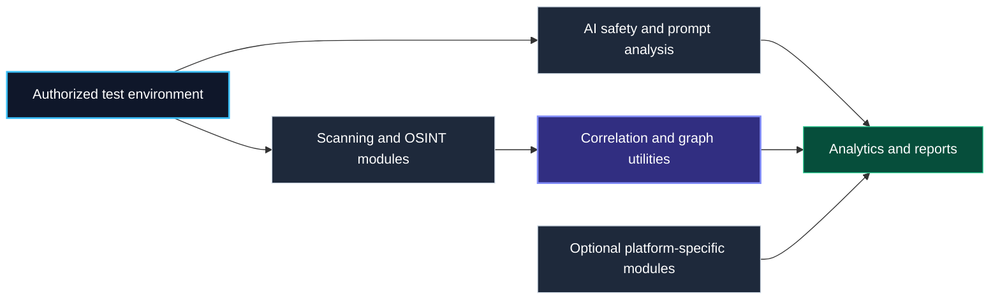

   
  <h1>🏛️ SANCTUM-SUITE</h1>
  
<b>Modular security engineering toolkit for audit workflows, AI safety experiments, and operational reporting</b>

  

    <i>Repozytorium zawiera moduły do audytów, analiz bezpieczeństwa, eksperymentów AI safety, raportowania i integracji infrastrukturalnych. Dostępność, dojrzałość, wymagania oraz skuteczność zależą od konkretnego modułu i środowiska; wymienione standardy nie oznaczają certyfikacji ani zgodności.</i>
  

  

    <a href="#cechy-systemu">Cechy Systemu</a> •
    <a href="#architektura-systemu">Architektura</a> •
    <a href="./docs/INSTALLATION.md">Instalacja</a> •
    <a href="./docs/CONTROL_CATALOG.md">Katalog kontroli</a> •
    <a href="./docs/RELEASE_CHECKLIST.md">Checklist wydania</a> •
    <a href="./LICENSE">Licencja</a>
  

  

    
    
    
    
  

   

---

## Cechy Systemu

**SANCTUM-SUITE** to zestaw modułów programistycznych do eksperymentów i wsparcia procesów bezpieczeństwa. Nie jest certyfikowanym produktem ani gwarancją ochrony środowiska.

Moduły opisane poniżej należy traktować jako funkcje repozytorium wymagające osobnej weryfikacji, konfiguracji i testów. Nie należy interpretować ich nazw jako niezależnej certyfikacji, pełnej implementacji standardu ani gwarancji skuteczności.

### Główne obszary kodu

- autoryzowane, dokładnie allowlistowane testy HTTPS/TCP oraz rejestrowanie zakresu (bez automatycznego odkrywania subdomen)
- analiza promptów, guardraile i narzędzia testów AI
- korelacja zdarzeń, generowanie reguł i raportowanie
- mapowanie kontroli zgodności oraz moduły infrastrukturalne

Repozytorium zawiera również eksperymentalne i platformowo zależne moduły dotyczące kontenerów, kryptografii, eBPF, ICS/SCADA i firmware. Sama obecność modułu nie potwierdza działania sprzętowego, produkcyjnej jakości ani zgodności z wymienionym standardem. Przed użyciem należy przejrzeć implementację oraz zweryfikować zachowanie w kontrolowanym środowisku.

Niepodłączone silniki skanowania kontenerów/SBOM, analizy firmware i pamięci, kampanii red-team, testów modeli, telemetrii EDR/XDR oraz inspekcji GPU raportują brak wykonanej oceny zamiast syntetycznych wyników. Moduły C2/covert-channel, spoofingu satelitarnego, biometrii, automatycznego naprawiania i dead-man switch nie wykonują tych działań. Moduły enklaw VRAM, pamięci kwantowo-odpornej i składowania informacji niejawnych nie zapewniają izolacji, atestacji ani magazynu danych. Szyfrowanie kopertowe `ZeroTrustKMSVault` używa klucza efemerycznego w pamięci procesu i nie zastępuje produkcyjnego KMS.

---

## Architektura Systemu

Poniższy schemat jest poglądową mapą grup modułów w repozytorium. Nie jest potwierdzonym przepływem danych, diagramem wdrożonej infrastruktury ani dowodem działania wszystkich komponentów:

---

## Wersja produkcyjna i monetyzacja

Repozytorium ma przygotowane materiały do wydania, instalacji i wstępnej rozmowy handlowej. To nie oznacza jeszcze zgody prawnej na sprzedaż ani potwierdzenia gotowości do wdrożeń produkcyjnych. Zweryfikowane elementy:

- build pakietu Python i dashboardu
- testy regresyjne oraz komendy CLI
- dokumentacja instalacji, polityki bezpieczeństwa i wstępnej strategii cenowej
- strona produktu i formularz kontaktowy wymagający konfiguracji webhooka

Dodatkowe materiały:

- [CHANGELOG.md](./CHANGELOG.md)
- [SECURITY.md](./SECURITY.md)
- [docs/RELEASE_CHECKLIST.md](./docs/RELEASE_CHECKLIST.md)
- [docs/MONETIZATION.md](./docs/MONETIZATION.md)
- [docs/INSTALLATION.md](./docs/INSTALLATION.md)
- [docs/CONTROL_CATALOG.md](./docs/CONTROL_CATALOG.md)
- [docs/COMMERCIAL_ENTITLEMENTS.md](./docs/COMMERCIAL_ENTITLEMENTS.md)
- [docs/RELEASE_PACK.md](./docs/RELEASE_PACK.md)
- [docs/SANCTUM-SUITE-Release-Overview.pdf](./docs/SANCTUM-SUITE-Release-Overview.pdf)
- [docs/RELEASE_NOTES_v6.0.0.md](./docs/RELEASE_NOTES_v6.0.0.md)
- [docs/AWS_DEPLOYMENT.md](./docs/AWS_DEPLOYMENT.md)

> Build i testy nie stanowią certyfikacji bezpieczeństwa ani gwarancji gotowości produkcyjnej. Licencja repozytorium ogranicza uruchamianie i użycie komercyjne bez pisemnej zgody właściciela praw.

Aktywne testy są blokowane, jeśli cel nie występuje dokładnie na liście `SANCTUM_AUTHORIZED_TARGETS`, brakuje identyfikatora pisemnej zgody lub nie skonfigurowano ważnego, podpisanego entitlementu. Szczegóły i limity znajdują się w [docs/COMMERCIAL_ENTITLEMENTS.md](./docs/COMMERCIAL_ENTITLEMENTS.md).

### Blokery przed sprzedażą i wdrożeniem

- obecna licencja nie zezwala na komercyjne użycie bez odrębnej pisemnej zgody; wymagany przegląd prawny i umowa komercyjna
- podpisane entitlementy Ed25519, lokalne liczniki użycia i ręczne wystawianie licencji z offlineowego CLI są dostępne; brak integracji płatności, unieważniania online, powiązania klucza API z tenantem, izolacji danych klientów i wdrożonego SLA; ceny na stronie są jedynie propozycją do omówienia
- formularz leadów wymaga webhooka, kontroli rate limitu po stronie operatora oraz finalnej polityki prywatności
- bezpieczeństwo, prawa dostępu i zachowanie każdego modułu trzeba zweryfikować dla docelowego środowiska przed uruchomieniem produkcyjnym