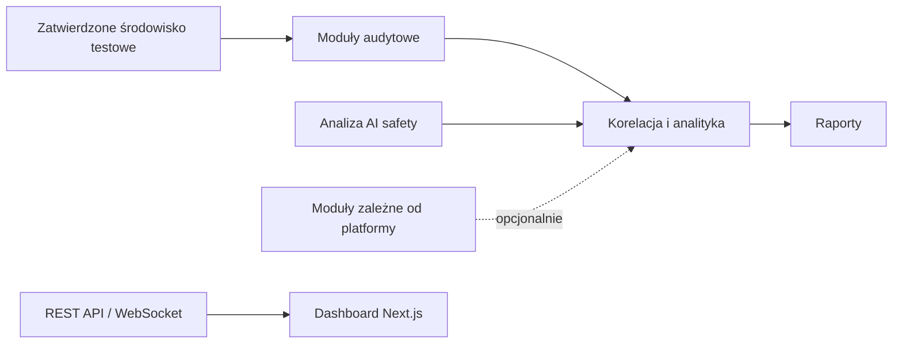

<div align="center">

# SANCTUM-SUITE

### Modułowy zestaw narzędzi do inżynierii bezpieczeństwa

Narzędzia CLI, API i dashboard wspierające wybrane procesy audytowe, analizę danych oraz eksperymenty z AI safety.

<p>
  
  
  
  
  
</p>

[Instalacja](./docs/INSTALLATION.md) ·
[Katalog kontroli](./docs/CONTROL_CATALOG.md) ·
[Laboratorium Parrot](./docs/PARROT_LAB.md) ·
[Przepływy specjalistyczne](./docs/SPECIALIZED_SECURITY.md) ·
[Pakiet offline](./docs/OFFLINE_RELEASE.md) ·
[Wdrożenie air-gapped/Podman](./docs/PODMAN_AIRGAP.md) ·
[Bezpieczeństwo](./SECURITY.md) ·
[Licencja](./LICENSE)

</div>

---

## O projekcie

SANCTUM-SUITE to rozwijany zestaw modułów programistycznych przeznaczonych do pracy w kontrolowanych, zatwierdzonych środowiskach. Repozytorium łączy narzędzia wiersza poleceń, API, funkcje analityczne i opcjonalny dashboard.

Projekt ma status **beta**. Zakres, dojrzałość i wymagania zależą od konkretnego modułu. Obecność funkcji w repozytorium nie oznacza, że została niezależnie zweryfikowana, jest gotowa do wdrożenia produkcyjnego ani zapewnia zgodność z określonym standardem.

## Możliwości

- **Audyt i testy** — wybrane, jawnie autoryzowane testy HTTPS/TCP z kontrolą dozwolonych celów.
- **Analiza i obsługa incydentów** — lokalna korelacja zdarzeń, trwałe sprawy SQLite, przypisania, statusy, notatki i odnośniki do dowodów, symulowane rekomendacje reakcji, audyt dostępu, opcjonalna retencja, fikcyjne scenariusze demonstracyjne oraz przygotowany, domyślnie wyłączony przepływ ingestii telemetrii przez push API i import JSON/JSONL/CEF. Opcjonalne OIDC zapewnia tokenową tożsamość użytkownika, role i oddzielne magazyny SQLite dla tenantów. Brak domyślnie aktywnych integracji dostawców i automatycznych reakcji.
- **AI safety** — moduły do analizy promptów i eksperymentów z zabezpieczeniami modeli.
- **Interfejsy** — CLI w Pythonie, REST API i WebSocket oraz osobny dashboard oparty na Next.js.
- **Kontrole i entitlementy** — mapowanie kontroli oraz weryfikacja podpisanych uprawnień do użycia.

### Ważne ograniczenia

Część modułów jest eksperymentalna, zależna od platformy lub stanowi jedynie punkt integracji. Repozytorium nie dostarcza działających integracji dla skanowania kontenerów/SBOM, analizy firmware i pamięci, telemetrii EDR/XDR, inspekcji GPU, sprzętowych enklaw ani magazynowania danych niejawnych. Funkcje kampanii red-team, C2/covert-channel, spoofingu satelitarnego, biometrii, hot-patchingu i dead-man switch nie wykonują opisanych działań. Brak integracji jest raportowany jako brak oceny, a nie jako pozytywny wynik.

Dashboard nie otrzymuje obecnie rzeczywistej telemetrii przez WebSocket. Znormalizowane dane można po jawnej konfiguracji źródła importować przez zabezpieczone API i przeglądać w Workbench; nie jest skonfigurowany konkretny dostawca ani harmonogram pull. Szyfrowanie `ZeroTrustKMSVault` działa lokalnie z kluczem efemerycznym wyłącznie w trybie developerskim albo przez jawnie skonfigurowany HashiCorp Vault Transit. Tryb produkcyjny i air-gapped wymaga Vault Transit; szczegóły opisuje [przewodnik instalacji](./docs/INSTALLATION.md#vault-transit-key-management).

OIDC wymaga jawnej konfiguracji issuer, audience, mapowania claimów oraz zabezpieczonego katalogu tenantów; nie zawiera interaktywnego logowania ani odświeżania tokenów. Profil produkcyjny/air-gapped wymaga OIDC, Vault Transit i MinIO Object Lock, a współdzielone klucze API są w nim odrzucane. Legacy API i analytics endpoints nie są dostępne dla tożsamości OIDC, ponieważ ich raportowanie nie jest tenant-scoped. Lokalny SQLite access audit nie jest immutable/tamper-proof; MinIO Object Lock może przechowywać minimalne, pseudonimizowane metadane żądań w trybie fail-closed przez 7 lat. Vault Transit szyfruje tylko dane jawnie przekazane do helpera; nie szyfruje automatycznie baz SQLite, logów ani kopii zapasowych. Mechanizmy te nie certyfikują środowiska ani nie dopuszczają do przetwarzania informacji niejawnych. Szczegóły i ograniczenia opisuje [przewodnik instalacji](./docs/INSTALLATION.md#oidc-users-roles-and-tenant-scoped-data) oraz [konfiguracja MinIO WORM](./docs/INSTALLATION.md#minio-immutable-access-audit).

Konfigurację i ograniczenia przygotowanego ingestu opisuje [przewodnik instalacji](./docs/INSTALLATION.md#preparing-external-telemetry-ingestion).

### Przygotowany przepływ danych telemetrycznych

Integracja jest **domyślnie wyłączona** i vendor-neutral. Po stronie serwera operator może skonfigurować mapę `SANCTUM_EVENT_SOURCE_KEYS` (ID źródła → osobny sekret o długości co najmniej 32 bajtów) oraz wymaganą politykę `SANCTUM_EVENT_RETENTION_DAYS` (1–36500 dni). Sekrety należy przechowywać w menedżerze sekretów, nigdy w dashboardzie ani repozytorium. Bez obu ustawień przyjmowanie danych jest zablokowane.

Obsługiwane ścieżki:

- **Push API:** `POST /api/v1/telemetry/ingest`, uwierzytelniane nagłówkami `X-Sanctum-Source-ID` i `X-Sanctum-Source-Key`.
- **Import plików:** `POST /api/v1/telemetry/import`; obsługiwane formaty JSON, JSONL i CEF, do 4 MB i 1000 zdarzeń na import. W Workbench można załadować plik, sprawdzić źródła i przeglądać zapisane, znormalizowane zdarzenia.
- **Pull:** dostępny jest zabezpieczony endpoint do ręcznego uruchamiania jawnie zarejestrowanych adapterów oraz wspólny kontrakt mapowania danych. Repozytorium nie zawiera konektora konkretnego dostawcy, harmonogramu pobierania ani domyślnych połączeń wychodzących.

Zdarzenia przechodzą walidację wspólnego schematu, a następnie trafiają do SQLite. Surowe payloady nie są zapisywane; identyfikatory źródłowe i tokeny korelacji są haszowane, a powtórzenia deduplikowane. Korelacja grupuje wyłącznie dokładne dopasowania pseudonimowych tokenów w skonfigurowanym oknie czasu — nie stanowi detekcji ani oceny zagrożenia. Tokeny pseudonimowe nie są anonimowe; przed wysłaniem danych należy ograniczyć je do niezbędnego zakresu i stosować zatwierdzoną politykę pseudonimizacji.

Konfiguracja endpointów i schematów znajduje się w [przewodniku instalacji](./docs/INSTALLATION.md#preparing-external-telemetry-ingestion). Podłączenie tej ścieżki nie uruchamia automatycznych reakcji ani nie zasila strumienia WebSocket.

## Szybki start

> **Uwaga licencyjna:** przed instalacją, uruchomieniem, modyfikacją lub wdrożeniem uzyskaj wymaganą pisemną zgodę właściciela praw. Licencja repozytorium pozwala na wgląd w kod w celach oceny, edukacyjnych lub code review; nie przyznaje ogólnego prawa do jego wykonywania ani użycia komercyjnego.

### Wymagania

- Python 3.11 lub nowszy
- Node.js i npm — tylko jeśli instalujesz dashboard
- Pisemna zgoda na użycie programu oraz osobna autoryzacja każdego testowanego celu

### Instalacja pakietu Python

Po uzyskaniu wymaganej zgody, w katalogu głównym repozytorium:

```powershell
py -3.11 -m venv .venv
.\.venv\Scripts\Activate.ps1
python -m pip install --upgrade pip
python -m pip install -e .
```

Sprawdzenie dostępnych poleceń i testy:

```powershell
sanctum --help
python -m pytest -q
```

### Dashboard (opcjonalnie)

```powershell
Set-Location .\sanctum-dashboard
npm ci
Copy-Item .env.example .env.local
npm run build
npm run start
```

Szczegóły konfiguracji API, TLS, sekretów i dashboardu opisuje [przewodnik instalacji](./docs/INSTALLATION.md).

## Użycie aktywnych testów

Aktywne audyty i skanowanie portów są blokowane, dopóki operator nie skonfiguruje wszystkich wymaganych elementów:

1. dokładnej listy dozwolonych celów w `SANCTUM_AUTHORIZED_TARGETS` — bez wildcardów;
2. identyfikatora pisemnej zgody przekazywanego przy uruchomieniu;
3. ważnego, podpisanego entitlementu oraz klucza publicznego do jego weryfikacji.

Przykładowe polecenie dla celu znajdującego się na skonfigurowanej liście i objętego ważną zgodą:

```powershell
sanctum run-audit --target zatwierdzony.example --authorization-reference "identyfikator-zgody"
```

Wartość `--authorization-reference` służy operatorowi do prowadzenia śladu audytowego — sama w sobie nie potwierdza zgody. Nie uruchamiaj testów wobec systemów spoza zatwierdzonego zakresu. Więcej informacji o uprawnieniach znajduje się w [dokumentacji entitlementów](./docs/COMMERCIAL_ENTITLEMENTS.md).

## Architektura

Diagram przedstawia orientacyjny podział obszarów repozytorium, a nie gwarantowany przepływ danych ani wdrożony układ infrastruktury.



## Dokumentacja

| Dokument | Opis |
|---|---|
| [Instalacja i wdrożenie](./docs/INSTALLATION.md) | Konfiguracja środowiska, API, dashboardu i wymagania wdrożeniowe |
| [Katalog kontroli](./docs/CONTROL_CATALOG.md) | Opis mapowanych kontroli |
| [Entitlementy komercyjne](./docs/COMMERCIAL_ENTITLEMENTS.md) | Podpisane uprawnienia, zakres i limity |
| [Polityka bezpieczeństwa](./SECURITY.md) | Zgłaszanie problemów bezpieczeństwa |
| [Lista kontrolna wydania](./docs/RELEASE_CHECKLIST.md) | Czynności przed wydaniem |
| [Informacje o wydaniu 6.0.0](./docs/RELEASE_NOTES_v6.0.0.md) | Zmiany w bieżącej wersji |
| [Changelog](./CHANGELOG.md) | Historia zmian |
| [Licencja](./LICENSE) | Warunki dostępu i użycia |

## Status wdrożeniowy

Repozytorium zawiera materiały do instalacji i wydania, ale **nie jest to potwierdzenie gotowości produkcyjnej**. Przed wdrożeniem należy zweryfikować zachowanie, uprawnienia i zależności każdego używanego modułu oraz przygotować właściwe zabezpieczenia środowiska.

Licencja nie zezwala na komercyjne użycie bez odrębnej pisemnej zgody. W repozytorium nie ma gotowej integracji płatności, unieważniania entitlementów online, izolacji danych klientów ani wdrożonego SLA. Formularz kontaktowy wymaga skonfigurowania zatwierdzonego webhooka. Build, testy i dokumentacja nie stanowią certyfikacji bezpieczeństwa, zgodności ani gwarancji skuteczności.

## Licencja

SANCTUM-SUITE jest udostępniany na warunkach ograniczonej licencji source-available. Przed jakimkolwiek użyciem zapoznaj się z pełnym tekstem pliku [LICENSE](./LICENSE) i uzyskaj pisemną zgodę, jeśli jest wymagana.
